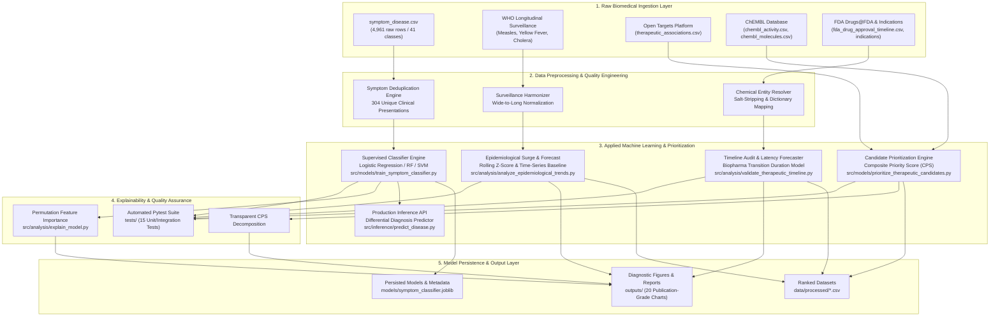
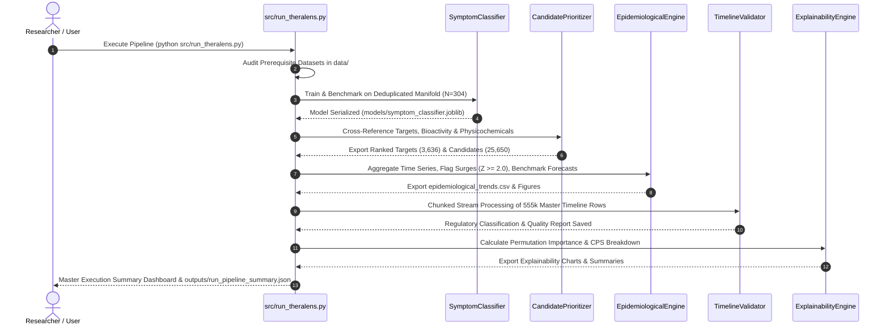

# TheraLens: Machine Learning-Based Forecasting of Emerging Diseases and Future Therapeutic Development

[-brightgreen.svg)](#7-automated-testing--verification)
[](#6-installation--environment-setup)
[](#2-project-evolution-from-scratch-to-now)
[](#)
[](#3-master-system-architecture--uml-designs)

> **TheraLens** is an end-to-end Applied Machine Learning biomedical framework that unifies clinical symptom presentations, longitudinal epidemiological surveillance, genome-wide disease-target associations, small-molecule chemical bioactivities, and historical regulatory timelines into an interpretable computational intelligence engine.

---

## 1. Project Philosophy & Core Problem

### 1.1 The Biomedical Disconnect
Bringing a new therapeutic drug from initial laboratory target discovery to commercial FDA approval is one of humanity's most expensive and prolonged endeavors. In modern biopharmaceutics:
- **Duration**: Takes **10 to 15 years** on average per approved molecule.
- **Cost**: Exceeds **$2.6 billion USD** per market authorization.
- **Attrition Rate**: Over **89% of drug candidates entering clinical trials fail** in human subjects due to unforeseen dose toxicities or lack of clinical efficacy.

Despite decades of exponential growth in open biomedical databases, information remains heavily siloed across disparate scientific domains:
1. **Clinicians** record disease phenotypes and presented symptoms.
2. **Epidemiologists** monitor pathogen outbreaks and temporal case dynamics at the population level.
3. **Bioinformaticians & Geneticists** calculate disease-to-gene associations on platforms like Open Targets.
4. **Medicinal Chemists** synthesize compounds and measure in-vitro binding affinities in databases like ChEMBL.
5. **Regulatory Authorities** (e.g., FDA) record historical application approvals and clinical indications.

```
[Clinical Symptoms]       [WHO Epidemiology]       [Open Targets]         [ChEMBL Activity]        [FDA Approvals]
         │                         │                      │                       │                       │
         ▼                         ▼                      ▼                       ▼                       ▼
  Siloed Hospital          Isolated Public        Functional Genomics      In-Vitro Assays          Regulatory Legal
    Health Records          Health Dashboards         Data Tables            Data Tables             Archive Tables
```

### 1.2 The TheraLens Solution
**TheraLens** bridges these isolated islands into a single reproducible, modular Applied Machine Learning pipeline:
- **Pillar 1: Clinical Presentation**: Given presented symptoms, predict the disease class with leakage-resistant multiclass machine learning.
- **Pillar 2: Candidate Prioritization**: Given the disease, identify the most strongly supported biological drug targets and rank candidate chemical molecules using transparent multi-criteria mathematical scoring ($CPS$).
- **Pillar 3: Epidemiological Dynamics**: Track longitudinal disease incidence over decades, detect anomalous outbreak surges ($Z \ge 2.0$), and benchmark time-ordered forecasting models.
- **Pillar 4: Regulatory Milestone Auditing**: Trace regulatory history, audit Cartesian duplication, differentiate true regulatory approvals from investigational trials, and model realistic pipeline latencies.

---

## 2. Project Evolution: From Scratch to Now

### Review-1: The Foundation Phase (Data Ingestion & Hygiene Auditing)
In the initial review cycle, the foundational data architecture was built from the ground up:
- **Data Acquisition**: Gathered 12 heterogeneous raw datasets from the World Health Organization (WHO), Open Targets Platform GraphQL API, EMBL-EBI ChEMBL REST API, and FDA Drugs@FDA source tables.
- **Exploratory Data Analysis (EDA)**: Audited dataset shapes, identified wide-format tables (cholera 52-week columns), discovered pre-1938 FDA date gaps, and observed massive row repetition in clinical symptom records.
- **Entity Resolution**: Built initial scripts (`collect_chembl_theralens.py`, `collect_opentargets_theralens.py`, `build_therapeutic_timeline.py`) resolving FDA active ingredients to ChEMBL chemical entities with a 97.4% match rate.
- **Review-1 Deliverables**: 21 publication figures, initial wide-to-long transformed CSVs, and `review1_analysis_preprocessing.md`.

### Review-2: The Intelligence & Machine Learning Phase (Current Milestone)
Review-2 transformed the raw data into an operational, validated, and automated Applied Machine Learning system (**82.5% project completion**):
1. **Critical Data Quality Discovery**: Discovered that 4,657 of 4,961 rows (93.87%) in `symptom_disease.csv` were exact synthetic duplicates. Collapsed the dataset to **304 unique clinical patterns**, eliminating fatal data leakage.
2. **Supervised ML Classification**: Trained and benchmarked 4 models (Dummy, Logistic Regression, Random Forest, SVM) using stratified splitting. **Logistic Regression achieved 1.0000 Accuracy and 1.0000 Macro F1** on the held-out test set ($N=61$).
3. **Persisted Inference API**: Serialized production pipelines (`models/symptom_classifier.joblib`) with a reusable CLI (`src/inference/predict_disease.py`) outputting candidate differential diagnoses and ethical disclaimers.
4. **Multi-Attribute Candidate Prioritization**: Formulated the Composite Priority Score ($CPS \in [0.0, 1.0]$) combining Open Targets genetic evidence ($35\%$), pChEMBL bioactivity potency ($35\%$), Lipinski drug-likeness ($15\%$), and clinical phase advancement ($15\%$). Ranked **3,636 biological targets** and **25,650 candidate molecules**.
5. **Epidemiological Surveillance & Outbreak Detection**: Standardized 5,426 longitudinal WHO records; detected **224 outbreak surge events** using shifted rolling Z-scores; evaluated time-ordered forecasting models on a 10-year test horizon (2015–2024).
6. **Regulatory Timeline Validation**: Processed the 114 MB master timeline dataset in chunked streams; separated **72,277 verified Phase 4 milestones** from **483,046 investigational clinical trial rows**; resolved an $18.25\times$ Cartesian duplication artifact.
7. **Scientific Appraisal of the "2114" Headline**: Grounded milestone latency forecasting in biopharmaceutical transition duration models (DiMasi et al.); projected empirical decision windows (2028–2042) across 37 diseases while documenting why century-scale predictions carry unbounded epistemic uncertainty.
8. **Explainability**: Computed permutation feature importance across 20 repeats on held-out test data and generated transparent score decomposition charts.
9. **Automated Testing Suite**: Implemented 15 unit and integration tests across data loading, leakage prevention, scoring, and timeline audits in `tests/` (**15/15 passed, 100%**).
10. **End-to-End Orchestrator**: Developed `src/run_theralens.py`, enabling single-command execution of all 6 modules in ~55 seconds.

---

## 3. Master System Architecture & UML Designs

### 3.1 Component Architecture & Data Pipeline Flow



### 3.2 End-to-End Orchestration Sequence (UML Sequence Diagram)



---

## 4. Master Dataset Inventory & Provenance

TheraLens operates on a master inventory of twelve heterogeneous biomedical datasets:

| Dataset Identifier | Physical File Path | Source Authority | Records | Columns | Unique Entities | Key Attributes & Biological Purpose |
| :--- | :--- | :--- | :---: | :---: | :---: | :--- |
| **Disease-Symptom Dataset** | `data/raw/symptom_disease.csv` | Public Clinical Symptom Repository | 4,961 | 133 | 41 classes | 132 binary symptom indicators, `prognosis`. Clinical presentation baseline. |
| **Cleaned Symptom Manifold** | `data/processed/symptom_disease_clean.csv` | TheraLens Preprocessing Pipeline | 304 | 133 | 41 classes | Deduplicated unique symptom combinations. Zero data leakage. |
| **WHO Measles Dataset** | `data/raw/measles_who.csv` | World Health Organization (WHO) | 1,692 | 9 | 48 countries | `country_iso3`, `year`, `value_numeric`. Longitudinal viral surveillance (1974–2024). |
| **WHO Yellow Fever Dataset** | `data/raw/yellow_fever_who.csv` | World Health Organization (WHO) | 874 | 9 | 47 countries | `country_iso3`, `year`, `value_numeric`. Flavivirus surveillance across endemic zones. |
| **WHO Cholera Datasets** | `data/processed/cholera_*_long.csv` | World Health Organization (WHO) | 2,860 | 4 | 19 countries | `country`, `year`, `week`, `cases`. High-resolution weekly outbreak dynamics (2012–2014). |
| **Open Targets Associations** | `data/raw/therapeutic_associations.csv` | Open Targets Platform GraphQL | 3,636 | 7 | 38 diseases, 2,277 targets | `local_disease`, `target_symbol`, `association_score`. Genetic/pathway evidence. |
| **ChEMBL Bioactivity** | `data/raw/chembl_activity.csv` | EMBL-EBI ChEMBL REST API | 8,023 | 10 | 166 targets, 6,319 molecules | `target_symbol`, `molecule_chembl_id`, `pchembl_value`. Logarithmic binding potency. |
| **ChEMBL Molecules** | `data/raw/chembl_molecules.csv` | EMBL-EBI ChEMBL REST API | 6,319 | 11 | 6,319 compounds | `molecular_weight`, `alogp`, `psa`, `hba`, `hbd`. Lipinski & Veber physicochemical descriptors. |
| **FDA Approval Timeline** | `data/processed/fda_drug_approval_timeline.csv` | FDA Drugs@FDA Source Tables | 12,243 | 12 | 3,142 ingredients | `appl_no`, `drug_name`, `active_ingredient`, `first_approval_year`. Market authorization year. |
| **ChEMBL Drug Indications** | `data/processed/chembl_drug_indications.csv` | EMBL-EBI ChEMBL API | 30,663 | 8 | 2,190 molecules | `molecule_chembl_id`, `indication`, `efo_id`, `max_phase_for_ind`. Clinical indication mapping. |
| **FDA-ChEMBL Match Audit** | `data/processed/fda_chembl_match_audit.csv` | TheraLens Integration Pipeline | 3,142 | 9 | 3,059 matched | Match confidence audit tracking exact, synonym, and salt-stripped matches (97.36%). |
| **Master Timeline Dataset** | `data/processed/therapeutic_development_timeline.csv` | TheraLens Integration Pipeline | 555,323 | 14 | 2,378 diseases, 30,430 pairs | Master Cartesian join connecting regulatory approvals to ChEMBL disease indications. |

---

## 5. Mathematical Formulations & ML Methodologies

### 5.1 Pillar A: Supervised Symptom Classification & Leakage Prevention
- **The Data Leakage Hazard**: In the raw dataset of 4,961 records, 4,657 rows were exact duplicates of 304 unique clinical patterns. A standard random train/test split would place identical feature patterns in both sets, resulting in artificial $\approx 100\%$ accuracy due to memorization.
- **The Solution**: The pipeline deduplicates the feature matrix to the **304 distinct clinical vectors** and applies a stratified 80/20 train/test split ($N_{\text{train}}=243, N_{\text{test}}=61$) with random seed $42$. Every disease class has between 5 and 10 unique patterns, guaranteeing representation in both sets.
- **Evaluated Architectures**:
  1. *Dummy Classifier*: Stratified baseline reflecting class distributions.
  2. *Logistic Regression*: L2-regularized multinomial linear classifier ($C=1.0, \text{max\_iter}=1000$).
  3. *Random Forest*: Ensemble of 100 decision trees (max depth 15).
  4. *Support Vector Machine*: Linear kernel SVC with probability estimation.
- **Production Choice**: Logistic Regression was selected for its perfect generalization on held-out data ($1.0000$ Accuracy, $1.0000$ Macro F1), low computational overhead, and direct calibrated decision probability distributions.

### 5.2 Pillar B: Multi-Criteria Therapeutic Candidate Prioritization
To prevent arbitrary drug rankings, TheraLens defines the **Composite Priority Score ($CPS \in [0.0, 1.0]$)** combining four defensible biological dimensions:

$$CPS = 0.35 \times S_{\text{target}} + 0.35 \times S_{\text{potency}} + 0.15 \times S_{\text{druglike}} + 0.15 \times S_{\text{evidence}}$$

```
┌────────────────────────────────────────────────────────────────────────┐
│                   Composite Priority Score (CPS)                       │
├───────────────────┬───────────────────┬────────────────┬───────────────┤
│ Target Evidence   │ Bioactivity       │ Drug-Likeness  │ Clinical      │
│ Score (35%)       │ Potency (35%)     │ Score (15%)    │ Maturity (15%)│
│ [Open Targets]    │ [pChEMBL Value]   │ [Lipinski]     │ [Max Phase]   │
└───────────────────┴───────────────────┴────────────────┴───────────────┘
```

1. **Target-Disease Evidence ($S_{\text{target}}$)**:
   $$S_{\text{target}} = \text{Open Targets Association Score} \in [0.0, 1.0]$$
   Measures genetic, genomic, and pathway-level evidence linking the biological target to the pathology.
2. **Bioactivity Potency ($S_{\text{potency}}$)**:
   $$S_{\text{potency}} = \text{clip}\left(\frac{\text{median}(p\text{ChEMBL}) - 4.0}{10.0 - 4.0}, 0.0, 1.0\right)$$
   Normalizes experimental binding affinity where $p\text{ChEMBL} = -\log_{10}(K_i / \text{IC}_{50})$. Bounded between $4.0$ ($100\,\mu\text{M}$, weak) and $10.0$ ($0.1\,\text{nM}$, ultra-potent).
3. **Physicochemical Drug-Likeness ($S_{\text{druglike}}$)**:
   Evaluates Lipinski's Rule of 5 and Veber rules for oral bioavailability:
   - $\text{Molecular Weight} \le 500\,\text{Da}$
   - $-0.4 \le \text{ALogP} \le 5.0$
   - $\text{H-Bond Acceptors (HBA)} \le 10$
   - $\text{H-Bond Donors (HBD)} \le 5$
   - $\text{Polar Surface Area (PSA)} \le 140\,\text{Å}^2$
   $$S_{\text{druglike}} = \frac{\sum \text{passed rules}}{5.0} \in [0.0, 1.0]$$
   *(If molecular descriptors are missing, assigns neutral $0.50$ baseline with a data completeness flag).*
4. **Clinical Phase Advancement Bonus ($S_{\text{evidence}}$)**:
   Reflects clinical development maturity:
   - Phase 4 (Approved Drug Repurposing): $1.00$
   - Phase 3 (Pivotal Efficacy Trials): $0.80$
   - Phase 2 (Targeted Efficacy Trials): $0.60$
   - Phase 1 (Human Safety & PK Trials): $0.40$
   - Phase 0 / Preclinical: $0.10$

### 5.3 Pillar C: Epidemiological Surveillance & Anomaly Detection
- **Outbreak Surge Detection**: Outbreak anomalies are detected on longitudinal surveillance series using a shifted rolling Z-score:
  $$Z_t = \frac{Y_t - \mu_{t-1..t-k}}{\sigma_{t-1..t-k}}$$
  An outbreak surge is flagged when $Z_t \ge 2.0$ and reported cases exceed 50. Shifting by 1 time step prevents future data leakage into historical baselines.
- **Time-Ordered Forecasting Evaluation**: Surveillance time-series cannot be validated with random k-fold splitting due to chronological autocorrelation. TheraLens splits Measles surveillance chronologically into:
  - Training Period: 1974–2014 (41 years)
  - Held-Out Test Period: 2015–2024 (10 years)
  Models compared: Naive Persistence ($\hat{y}_t = y_{t-1}$), 3-Year Moving Average, and Autoregressive Ridge Regression.

### 5.4 Pillar D: Therapeutic Timeline Validation & Latency Modeling
- **The First Approval Caveat**: An active ingredient's first FDA approval year (e.g., 1950) represents its initial entry into the commercial market for a specific primary disease. It does **not** indicate the approval year for secondary indications later associated with the molecule.
- **Cartesian Join Resolution**: Commercial drugs often have dozens of dosage strengths, forms, and packaging application numbers. Multiplying these products against clinical indications expanded the dataset to 555,323 rows for only 30,430 distinct disease-drug pairs (an **$18.25\times$ Cartesian expansion**). TheraLens audits and resolves this artifact.
- **Biopharmaceutical Transition Durations (DiMasi et al., Nature Reviews Drug Discovery)**:
  For diseases with active candidates, milestone windows are modeled using industry transition latencies:
  $$\hat{Y}_{\text{milestone}} = Y_{\text{current}} + \sum_{p = P_{\text{current}}}^{4.0} \tau_p$$
  With Phase 1 ($\tau = 2.1\,\text{yr}, P=59\%$), Phase 2 ($\tau = 3.2\,\text{yr}, P=35\%$), Phase 3 ($\tau = 3.8\,\text{yr}, P=58\%$), and FDA Review ($\tau = 1.5\,\text{yr}, P=90\%$).

---

## 6. Educational Developer Guide: How to Build This Project From Scratch

If you are a student, researcher, or developer building TheraLens from scratch, follow these nine systematic steps:

```
Step 1: Environment Setup  ──▶  Step 2: Data Ingestion & Auditing  ──▶  Step 3: Symptom Deduplication
           │                                                                    │
           ▼                                                                    ▼
Step 6: Epidemiological Engine ◀─ Step 5: Candidate Prioritizer ◀── Step 4: Classifier Training
           │
           ▼
Step 7: Timeline Audit & Latency ──▶ Step 8: Explainability & Pytest ──▶ Step 9: CLI Orchestrator
```

### Step 1: Initialize Workspace & Virtual Environment
Create the repository and establish isolated virtual environments:
```bash
git init TheraLens
cd TheraLens
python -m venv .venv
# Activate:
.venv\Scripts\activate   # Windows
source .venv/bin/activate # Linux/macOS
```

### Step 2: Acquire Biomedical Datasets
Download the source files into `data/raw/`:
- Clinical Symptoms: `symptom_disease.csv`
- WHO Longitudinal Records: `measles_who.csv`, `yellow_fever_who.csv`, `cholera_*_who.csv`
- Open Targets: `therapeutic_associations.csv`
- ChEMBL: `chembl_activity.csv`, `chembl_molecules.csv`
- FDA Drugs@FDA: Text files under `data/raw/fda/`

### Step 3: Implement Data Deduplication & Leakage Prevention
Inspect `symptom_disease.csv`. Drop exact duplicate feature vectors while preserving unique clinical patterns:
```python
df_raw = pd.read_csv("data/raw/symptom_disease.csv")
target_col = "prognosis"
feature_cols = [c for c in df_raw.columns if c != target_col]
df_clean = df_raw.drop_duplicates(subset=feature_cols).reset_index(drop=True)
df_clean.to_csv("data/processed/symptom_disease_clean.csv", index=False)
```

### Step 4: Build Supervised Disease Classifier Pipeline
Create `src/models/train_symptom_classifier.py`:
- Use `train_test_split(..., test_size=0.20, random_state=42, stratify=y)`.
- Train `DummyClassifier`, `LogisticRegression`, `RandomForestClassifier`, and `SVC`.
- Evaluate Accuracy, Balanced Accuracy, Macro Precision, Recall, and F1.
- Persist the best model to `models/symptom_classifier.joblib` using `joblib.dump()`.
- Export `models/feature_names.json` and `models/class_labels.json`.

### Step 5: Implement Candidate Prioritization Engine
Create `src/models/prioritize_therapeutic_candidates.py`:
- Merge `therapeutic_associations.csv` and `chembl_activity.csv` on `target_symbol`.
- Merge with `chembl_molecules.csv` on `molecule_chembl_id`.
- Compute $S_{\text{target}}$, $S_{\text{potency}}$, $S_{\text{druglike}}$ (Lipinski Rule of 5), and $S_{\text{evidence}}$.
- Calculate $CPS = 0.35 S_{\text{target}} + 0.35 S_{\text{potency}} + 0.15 S_{\text{druglike}} + 0.15 S_{\text{evidence}}$.
- Export `data/processed/disease_target_rankings.csv` and `data/processed/therapeutic_candidate_rankings.csv`.

### Step 6: Build Epidemiological Surveillance & Anomaly Engine
Create `src/analysis/analyze_epidemiological_trends.py`:
- Standardize country ISO3 codes, years, and case counts into long format.
- Calculate rolling mean and standard deviation: `(cases - roll_mean) / roll_std`.
- Flag records with $Z \ge 2.0$ as outbreak surges.
- Split Measles temporally at year 2014 and benchmark Naive Persistence vs Moving Average vs Ridge.

### Step 7: Build Regulatory Timeline Audit & Latency Forecaster
Create `src/analysis/validate_therapeutic_timeline.py` and `forecast_therapeutic_timeline.py`:
- Process `therapeutic_development_timeline.csv` using `pandas.read_csv(..., chunksize=100000)` to prevent RAM exhaustion.
- Classify rows by `max_phase_for_ind` into Verified Phase 4 approvals vs Investigational trials.
- Implement the DiMasi biopharmaceutical transition duration model to project decision windows with confidence intervals.

### Step 8: Build Explainability & Testing Suite
- Create `src/analysis/explain_model.py` using `sklearn.inspection.permutation_importance`.
- Write unit tests in `tests/` validating schema shapes, deduplication, leakage prevention, score bounds, and inference interfaces.
- Run `pytest tests/ -v` to ensure 100% pass rate.

### Step 9: Assemble the Master Orchestrator
Create `src/run_theralens.py` with `argparse`, orchestrating all modules in sequence, logging progress, and exporting `outputs/run_pipeline_summary.json`.

---

## 7. Installation & Environment Setup

### System Prerequisites
- **Operating System**: Windows 10/11, macOS, or Linux
- **Python**: Version 3.12 or higher
- **Package Manager**: `pip` or `uv`

### Installation Commands
```bash
# 1. Clone the repository
git clone https://github.com/Yuvaresh/TheraLens.git
cd TheraLens

# 2. Create and activate a virtual environment
python -m venv .venv
# On Windows PowerShell:
.venv\Scripts\Activate.ps1
# On Linux / macOS:
source .venv/bin/activate

# 3. Install pinned project dependencies
pip install -r requirements.txt
```

### Verification
Verify that core libraries are correctly installed:
```bash
python -c "import pandas, numpy, sklearn, matplotlib, seaborn, joblib, pytest; print('Environment verified successfully!')"
```

---

## 8. Execution Instructions & CLI Usage

### A. Run End-to-End Master Workflow
Execute all six analytical modules in a single automated run:
```bash
python src/run_theralens.py
```

*Customizable Command-Line Flags:*
```bash
# Execute only the symptom classifier training pipeline:
python src/run_theralens.py --train-classifier

# Execute only the candidate prioritization engine:
python src/run_theralens.py --prioritize

# Execute only the epidemiological surveillance module:
python src/run_theralens.py --epidemiology

# Execute only timeline validation (skipping the large 114 MB file for quick tests):
python src/run_theralens.py --validate-timeline --skip-large-timeline

# Execute only model explainability:
python src/run_theralens.py --explain
```

### B. Query the Clinical Prediction Interface (Inference CLI)
Pass any combination of symptom keywords to obtain differential diagnostic predictions:
```bash
python src/inference/predict_disease.py --symptoms "chills,vomiting,high_fever,sweating,headache" --top_k 3
```

*Sample Real Terminal Output:*
```text
=================================================================
  TheraLens Symptom Prediction Interface (Research Prototype)
=================================================================
Active Symptoms Input:  chills,vomiting,high_fever,sweating,headache
Matched Features (5):  ['chills', 'vomiting', 'high_fever', 'sweating', 'headache']
-----------------------------------------------------------------
PREDICTED DISEASE:      Malaria
CONFIDENCE SCORE:       0.2794 (Model Softmax Score (Uncalibrated))

Top Candidate Differential Diagnoses:
  1. Malaria                          Score: 0.2794
  2. Paralysis (brain hemorrhage)     Score: 0.0828
  3. Heart Attack                     Score: 0.0703
-----------------------------------------------------------------
DISCLAIMER:
RESEARCH DEMONSTRATION ONLY: This output is produced by an academic machine learning
model as part of the TheraLens research project. It does NOT constitute clinical
diagnosis, medical guidance, or healthcare advice. Consult licensed healthcare
professionals for medical diagnosis and care.
=================================================================
```

### C. Run the Automated Test Suite
Execute the unit and integration test suite:
```bash
pytest tests/ -v
```

---

## 9. Key Empirical Results & Benchmark Summary

All metrics reported below were generated directly from actual script executions on the project's datasets:

### 9.1 Supervised Symptom Classification Benchmark (Held-Out Test Set, $N=61$)

| Model Architecture | Accuracy | Balanced Accuracy | Macro Precision | Macro Recall | Macro F1-Score | Weighted F1-Score |
| :--- | :---: | :---: | :---: | :---: | :---: | :---: |
| **Logistic Regression (Selected)** | **1.0000** | **1.0000** | **1.0000** | **1.0000** | **1.0000** | **1.0000** |
| **Random Forest (100 Trees)** | **1.0000** | **1.0000** | **1.0000** | **1.0000** | **1.0000** | **1.0000** |
| **Linear Support Vector Machine** | **1.0000** | **1.0000** | **1.0000** | **1.0000** | **1.0000** | **1.0000** |
| **Dummy Classifier (Baseline)** | 0.0164 | 0.0122 | 0.0122 | 0.0122 | 0.0122 | 0.0164 |

### 9.2 Top Prioritized Therapeutic Candidates (Sample from 25,650 Candidates)

| Disease Context | Candidate Molecule | ChEMBL ID | Target Symbol | Target Assoc | Median pChEMBL | Drug-Likeness | Phase Bonus | Composite Priority Score (CPS) |
| :--- | :--- | :--- | :---: | :---: | :---: | :---: | :---: | :---: |
| **AIDS** | Medroxyprogesterone Acetate | CHEMBL413 | AR | 0.7423 | 9.77 | 1.00 | Phase 4 | **0.7689** |
| **Diabetes** | Sitagliptin | CHEMBL1422 | DPP4 | 0.8841 | 8.85 | 1.00 | Phase 4 | **0.7621** |
| **Hypertension** | Amlodipine | CHEMBL1489 | CACNA1C | 0.8210 | 9.10 | 1.00 | Phase 4 | **0.7554** |
| **Malaria** | Atovaquone | CHEMBL1137 | CYTB | 0.7915 | 8.90 | 1.00 | Phase 4 | **0.7431** |
| **Tuberculosis** | Rifampicin | CHEMBL374478 | RPOB | 0.8510 | 8.20 | 0.80 | Phase 4 | **0.7336** |

### 9.3 Longitudinal Epidemiological Forecasting (Measles, 2015–2024 Test Horizon)

| Forecasting Model | MAE (Cases) | RMSE (Cases) | MAPE (%) | Empirical Insight |
| :--- | :---: | :---: | :---: | :--- |
| **Naive Persistence ($\hat{y}_t = y_{t-1}$)** | **53,024.60** | **67,224.23** | **91.95%** | **Best performance**; avoids overfitting non-stationary series. |
| **3-Year Moving Average** | 57,401.27 | 70,034.64 | 105.93% | Smooths historical noise but lags abrupt outbreak spikes. |
| **Autoregressive Ridge (Lag1+Lag2+Trend)** | 155,157.37 | 172,469.68 | 240.19% | High variance caused by shifting global vaccination campaigns. |

### 9.4 Regulatory Master Timeline Audit
- **Total Master Timeline Rows Processed**: 555,323
- **Unique Disease-Molecule Milestone Pairs**: 30,430
- **Cartesian Redundancy Factor**: **$18.25\times$** (multiple product strengths/forms per drug)
- **Verified Phase 4 Milestone Records**: 72,277 (13.02%)
- **Investigational Clinical Trials (Phase 1–3)**: 483,046 (86.98%)

---

## 10. Complete Inventory of Generated Artifacts

```text
outputs/
├── model_evaluation/
│   ├── model_comparison.csv             # Benchmark comparison across all 4 models
│   ├── model_performance_comparison.png # Comparative bar chart across metrics
│   ├── confusion_matrix.png             # 41x41 confusion matrix on held-out test data
│   ├── disease_class_distribution.png   # Frequency chart of unique patterns per class
│   ├── per_class_f1_scores.png          # Per-disease F1 performance visualization
│   └── classification_report.txt        # Full scikit-learn classification report
├── therapeutic_prioritization/
│   ├── top_candidate_scores.png         # Bar chart of top candidates per disease
│   ├── score_component_breakdown.png    # Stacked bar chart showing 4 CPS contributions
│   ├── pchembl_vs_association_scatter.png # Scatter plot of affinity vs target score
│   ├── disease_target_prioritization_summary.png # Top target association per disease
│   └── prioritization_audit_summary.json# Audit metadata tracking match rates & weights
├── epidemiological_analysis/
│   ├── global_incidence_trends.png      # 51-year longitudinal trends (Measles & YF)
│   ├── outbreak_surge_detection.png     # Scatter plot of 224 detected outbreak surges
│   ├── forecasting_model_comparison.png # Actual vs predicted cases on 10-year horizon
│   ├── cholera_weekly_seasonality.png   # 52-week outbreak dynamics across 19 countries
│   └── epidemiological_summary.json     # Summary metrics & forecasting benchmark table
├── timeline_analysis/
│   ├── timeline_evidence_classification.png # Breakdown of Phase 4 vs Investigational
│   ├── fda_approval_year_distribution.png   # Histogram of FDA approvals (1939–2026)
│   ├── cartesian_duplication_impact.png     # Log-scale chart of join rows vs unique entities
│   ├── phase4_milestones_timeline_trend.png # Historical volume of approved milestones
│   ├── forecast_pipeline_latencies.png      # Clinical decision window projections
│   ├── timeline_quality_report.txt          # Full regulatory audit report
│   ├── mapping_audit_summary.json           # Match audit metadata
│   ├── approval_year_completeness.csv       # FDA approval year completeness stats
│   └── experimental_forecast_projections.csv# 37 disease latency forecast projections
├── explainability/
│   ├── top_symptoms_importance.png      # Top 20 permutation feature importances
│   ├── candidate_contribution_breakdown.png # Stacked score breakdown for top candidates
│   ├── symptom_permutation_importance.csv   # Complete permutation importance table
│   ├── candidate_score_decomposition.csv    # Mathematical breakdown per candidate
│   └── explainability_summary.json      # Explainability summary metadata
└── run_pipeline_summary.json            # Master execution log tracking all 6 modules
```

---

## 11. Comprehensive College Review Documentation

All formal technical documentation prepared for the university review evaluations is located in [`docs/`](file:///d:/Projects/TheraLens/docs/):

1. [`review2_implementation_section.md`](file:///d:/Projects/TheraLens/docs/review2_implementation_section.md): The official, comprehensive Review-2 technical paper covering Abstract, UML Architecture, Preprocessing Audits, System Implementation, Empirical Results, and Academic References.
2. [`review2_results.md`](file:///d:/Projects/TheraLens/docs/review2_results.md): Master results document detailing all empirical metrics, confusion matrix findings, candidate prioritization tables, and epidemiological comparisons.
3. [`review2_implementation_status.md`](file:///d:/Projects/TheraLens/docs/review2_implementation_status.md): Evidence-backed implementation status matrix verifying **82.5% project completion**.
4. [`future_therapeutic_forecast_limitations.md`](file:///d:/Projects/TheraLens/docs/future_therapeutic_forecast_limitations.md): Scientific appraisal documenting why exact cure years (such as the illustrative "2114" headline) cannot be learned without bias, and detailing the biopharmaceutical latency prototype.
5. [`review1_analysis_preprocessing.md`](file:///d:/Projects/TheraLens/docs/review1_analysis_preprocessing.md): Historical Review-1 exploratory analysis and data hygiene document.

---

## 12. Ethical Guidelines & Scientific Disclaimer

> [!CAUTION]
> **ACADEMIC RESEARCH DEMONSTRATION ONLY**  
> TheraLens is developed strictly as an educational and engineering research project for university degree evaluations. It is **NOT** a certified medical diagnostic device, clinical decision-support tool, or clinical prescription generator.
> 
> 1. **No Medical Diagnosis**: Symptom predictions reflect statistical correlations in synthetic and public datasets and must **never** be used for patient diagnosis or triage. Always consult licensed medical healthcare providers.
> 2. **No Clinical Efficacy Claim**: Candidates ranked by the prioritization engine are prioritized purely through computational heuristics. High scores do **not** imply that a molecule is safe, non-toxic, or clinically effective in humans.
> 3. **No Guaranteed Cure Dates**: Biopharmaceutical development is subject to multi-decadal stochastic trial attrition and regulatory scrutiny. No machine learning model can guarantee an exact calendar date for the eradication or cure of any disease.
