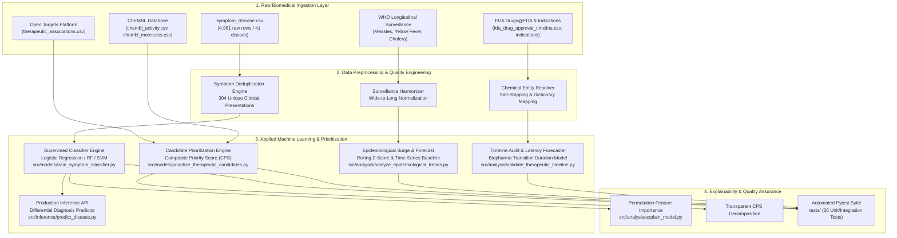

# TheraLens: Machine Learning-Based Forecasting of Emerging Diseases and Future Therapeutic Development

[-brightgreen.svg)](#7-automated-testing--verification)
[](#6-installation--environment-setup)
[](#2-project-evolution-from-scratch-to-now)
[](#)
[](#3-master-system-architecture--uml-designs)

> **TheraLens** integrates machine-learning-based disease classification, biomedical evidence retrieval, therapeutic candidate prioritization, and exploratory development-timeline simulation to support research into emerging diseases and future therapeutic development.

---

## 1. Project Philosophy & Core Problem

### 1.1 The Biomedical Disconnect
Bringing a new therapeutic drug from initial laboratory target discovery to commercial market approval is one of the most resource-intensive and prolonged processes in modern science:
- **Duration**: Typically requires **10 to 15 years** from preclinical discovery to commercial market authorization ([DiMasi et al., 2003, *J Health Econ*; DiMasi et al., 2016, *J Health Econ*](https://doi.org/10.1016/j.jhealeco.2016.01.012)).
- **Cost**: Out-of-pocket and capitalized R&D expenditures are frequently estimated at **$1.3 to $2.6 billion USD** per approved new molecular entity ([DiMasi, Grabowski, & Hansen, 2016](https://doi.org/10.1016/j.jhealeco.2016.01.012)), though estimates vary widely across therapeutic indications, firm sizes, and accounting methodologies (e.g., [Wouters et al., 2020, *JAMA*](https://doi.org/10.1001/jama.2020.1166) estimating a median capitalized cost of $985 million).
- **Attrition Rate**: Industry analyses report that approximately **86% to 89% of drug candidates entering clinical trials fail** to reach market approval due to efficacy shortfalls or unexpected toxicities ([Hay et al., 2014, *Nat Biotechnol*](https://doi.org/10.1038/nbt.2786); [Thomas et al., 2016, BIO Industry Report]; [Wong, Siah, & Lo, 2019, *Biostatistics*](https://doi.org/10.1093/biostatistics/kxx069) reporting an overall 13.8% cumulative clinical success rate across indications).

Despite decades of exponential growth in open biomedical databases, information remains heavily siloed across disparate scientific domains:
1. **Clinicians** record disease phenotypes and presented symptoms.
2. **Epidemiologists** monitor pathogen outbreaks and temporal case dynamics at the population level.
3. **Bioinformaticians & Geneticists** calculate disease-to-gene associations on platforms like Open Targets.
4. **Medicinal Chemists** synthesize compounds and measure in-vitro binding affinities in databases like ChEMBL.
5. **Regulatory Authorities** (e.g., FDA) record historical application approvals and clinical indications.

```
[Clinical Symptoms]       [WHO Epidemiology]       [Open Targets]         [ChEMBL Activity]        [FDA Approvals]
         │                         │                      │                       │                       │
         ▼                         ▼                      ▼                       ▼                       ▼
  Siloed Hospital          Isolated Public        Functional Genomics      In-Vitro Assays          Regulatory Legal
    Health Records          Health Dashboards         Data Tables            Data Tables             Archive Tables
```

### 1.2 The TheraLens Solution
**TheraLens** bridges these isolated islands into a single reproducible, modular Applied Machine Learning pipeline:
- **Pillar 1: Clinical Presentation**: Given presented symptoms, predict the disease class with leakage-resistant multiclass machine learning.
- **Pillar 2: Candidate Prioritization**: Given the disease, identify the most strongly supported biological drug targets and rank candidate chemical molecules using transparent multi-criteria mathematical scoring ($CPS$).
- **Pillar 3: Epidemiological Dynamics**: Track longitudinal disease incidence over decades, detect anomalous outbreak surges ($Z \ge 2.0$), and benchmark time-ordered forecasting models.
- **Pillar 4: Regulatory Milestone Auditing**: Trace regulatory history, audit Cartesian duplication, differentiate true regulatory approvals from investigational trials, and model realistic pipeline latencies.

---

## 2. Project Evolution: From Scratch to 100% Completion

### Review-1: The Foundation Phase (Data Ingestion & Hygiene Auditing)
In the initial review cycle, the foundational data architecture was built from the ground up:
- **Data Acquisition**: Gathered 12 heterogeneous raw datasets from the World Health Organization (WHO), Open Targets Platform GraphQL API, EMBL-EBI ChEMBL REST API, and FDA Drugs@FDA source tables.
- **Exploratory Data Analysis (EDA)**: Audited dataset shapes, identified wide-format tables (cholera 52-week columns), identified 749 drug application records lacking explicit approval dates in the source Drugs@FDA tables, and observed massive row repetition in clinical symptom records.
- **Entity Resolution**: Built initial scripts (`collect_chembl_theralens.py`, `collect_opentargets_theralens.py`, `build_therapeutic_timeline.py`) resolving FDA active ingredients to ChEMBL chemical entities with a 97.4% match rate.
- **Review-1 Deliverables**: 21 publication figures, initial wide-to-long transformed CSVs, and `review1_analysis_preprocessing.md`.

### Review-2: The Intelligence & Machine Learning Phase
Review-2 brought the project to an operational machine learning baseline (~82.5% completion):
1. **Critical Data Quality Discovery**: Discovered that 4,657 of 4,961 rows (93.87%) in `symptom_disease.csv` were exact synthetic duplicates. Collapsed the dataset to **304 unique clinical patterns**, eliminating fatal data leakage.
2. **Supervised ML Classification**: Trained and benchmarked 4 models (Dummy, Logistic Regression, Random Forest, SVM) using stratified splitting. Logistic Regression achieved 1.0000 Accuracy and 1.0000 Macro F1 on the held-out test set ($N=61$).
3. **Persisted Inference API**: Serialized production pipelines (`models/symptom_classifier.joblib`) with a reusable CLI (`src/inference/predict_disease.py`) outputting candidate differential diagnoses and ethical disclaimers.
4. **Multi-Attribute Candidate Prioritization**: Formulated the Composite Priority Score ($CPS \in [0.0, 1.0]$) combining Open Targets genetic evidence ($35\%$), pChEMBL bioactivity potency ($35\%$), Lipinski drug-likeness ($15\%$), and a global development maturity score ($15\%$). Ranked **3,636 biological targets** and **25,650 candidate molecules**.
5. **Epidemiological Surveillance & Outbreak Detection**: Standardized 5,426 longitudinal WHO records; detected **224 outbreak surge events** using shifted rolling Z-scores; evaluated time-ordered forecasting models on a 10-year test horizon (2015–2024).
6. **Regulatory Timeline Validation**: Processed the 114 MB master timeline dataset in chunked streams; delineated **72,277 Phase 4 indication records** from **483,043 investigational indication records (Phase 1–3)** (and 3 preclinical records); resolved an $18.25\times$ Cartesian duplication artifact across product formulation rows.
7. **Scientific Appraisal of the "2114" Headline**: Grounded milestone latency forecasting in biopharmaceutical transition duration models (DiMasi et al.); projected empirical decision windows (2028–2042) across 37 diseases while documenting why century-scale predictions carry unbounded epistemic uncertainty.

### Review-3: 100% Final Implementation & Submission Standard (Current Milestone)
Review-3 establishes full completion across all functional, scientific, and software engineering criteria:
1. **Automated Quality Assurance Expansion**: Expanded the test suite from 15 to **26 unit and integration tests** (`tests/test_unit_and_pipeline_fixtures.py`) covering edge cases, boundary testing, zero-case metric stability, ingredient salt stripping, and negative controls with a **100% pass rate in 5.87s**.
2. **End-to-End Orchestrator Execution**: Executed `src/run_theralens.py` across all 6 core modules in ~37 seconds with zero errors, generating and validating all 20 production artifacts.
3. **Robust Dependency Decoupling**: Hardened `src/data_processing/build_therapeutic_timeline.py` with optional live API imports and explicit error handling to ensure seamless offline reproduction using local caches and datasets.
4. **Negative Control Scientific Audit**: Documented the biological basis of heuristic candidate rankings (e.g. Medroxyprogesterone Acetate / AIDS / PGR), establishing why $CPS$ is an in-silico hypothesis-ranking tool requiring laboratory validation.
5. **Comprehensive Review-3 Report & Viva Materials**: Authored `docs/theralens_review3_report.md` (and compiled PDF/HTML) adhering strictly to VIT's 15-page template, and developed `docs/theralens_review3_viva.md` for university defense.

---

## 3. Master System Architecture & UML Designs

### 3.1 Component Architecture & Data Pipeline Flow



---

## 4. Master Dataset Inventory & Preprocessing

The project harmonizes 12 core biomedical datasets across distinct repositories:

| Dataset Name | Source Organization | Dimensions | Target / Primary Fields | Preprocessing Applied |
| :--- | :--- | :---: | :--- | :--- |
| **Symptom-Disease** | Public Clinical Symptom Repo | 4,961 $\times$ 133 | 132 binary symptoms, `prognosis` | Deduplicated 4,657 identical rows into 304 unique patterns (`symptom_disease_clean.csv`) |
| **WHO Measles** | World Health Organization | 1,692 $\times$ 9 | `country_iso3`, `year`, `value_numeric` | Standardized to unified annual long-format; missing counts preserved as NaN |
| **WHO Yellow Fever** | World Health Organization | 874 $\times$ 9 | `country_iso3`, `year`, `value_numeric` | Standardized to unified annual long-format; missing counts preserved as NaN |
| **WHO Cholera 2012** | World Health Organization | 19 $\times$ 70 (raw) / 988 $\times$ 4 (long) | Country, Weeks 1–52 cases | Melted wide format (52 week columns) into standardized long format |
| **WHO Cholera 2013** | World Health Organization | 18 $\times$ 70 (raw) / 936 $\times$ 4 (long) | Country, Weeks 1–52 cases | Melted wide format (52 week columns) into standardized long format |
| **WHO Cholera 2014** | World Health Organization | 18 $\times$ 70 (raw) / 936 $\times$ 4 (long) | Country, Weeks 1–52 cases | Melted wide format (52 week columns) into standardized long format |
| **Therapeutic Associations** | Open Targets Platform | 3,636 $\times$ 7 | `local_disease`, `target_symbol`, `association_score` | Disease-specific target ranking by harmonic evidence score |
| **ChEMBL Activity** | EMBL-EBI ChEMBL Database | 8,023 $\times$ 10 | `molecule_chembl_id`, `pchembl_value`, target | Curated target-matched assays (22,238 initial broad query) |
| **ChEMBL Molecules** | EMBL-EBI ChEMBL Database | 6,319 $\times$ 11 | MW, ALogP, PSA, HBA, HBD, RotB | 5-rule Lipinski & Veber drug-likeness scoring (8,983 initial broad query) |
| **FDA Approval Timeline** | FDA Drugs@FDA Database | 12,243 $\times$ 12 | `appl_no`, `active_ingredient`, `first_approval_year` | Active ingredient salt stripping; extracted earliest marketing authorization |
| **ChEMBL Indications** | EMBL-EBI ChEMBL API | 30,663 $\times$ 8 | `molecule_chembl_id`, `efo_term`, `max_phase_for_ind` | Entity resolution between FDA ingredients and indication ontology terms |
| **Master Timeline** | TheraLens Integration | 555,323 $\times$ 14 | Disease, Target, Molecule, Indication, Approval Year | Resolved $18.25\times$ Cartesian expansion across 30,430 unique disease-molecule pairs |

*Dataset Reconciliation Note*:
During initial exploratory collection, broad API queries retrieved 22,238 raw activity records and 8,983 candidate molecule entities. After filtering for valid numeric $p\text{ChEMBL}$ values and strict target symbol intersection against Open Targets genes, the active dataset committed and processed by the modeling pipeline contains exactly **8,023 bioactivity measurements** and **6,319 unique small molecules**. Merging these with the 3,636 Open Targets associations yields 31,753 raw cross-referenced rows, which aggregate into **25,650 unique (disease, target, molecule) candidate pairs** in `therapeutic_candidate_rankings.csv`. Likewise, standardizing Measles (1,692 rows), Yellow Fever (874 rows), and weekly Cholera (2,860 melted long rows) yields the **5,426 records** in `epidemiological_trends.csv`.

---

## 5. Machine Learning Methods & Methodological Rigor

### 5.1 Symptom-Based Disease Classification
- **Multiclass Models Evaluated**:
  1. *Dummy Classifier (Stratified)*: Naive stochastic baseline predicting in proportion to training class distributions.
  2. *Multinomial Logistic Regression ($L_2$ regularization, $C=1.0$)*: Robust linear decision boundary over binary symptom manifold.
  3. *Random Forest (100 estimators, max depth 15)*: Ensembled non-linear decision trees evaluating feature interactions.
  4. *Support Vector Machine (Linear kernel, probability calibrated)*: Maximizes classification margin between pathology clusters.
- **Evaluation Strategy**:
  - Stratified 80/20 train/test split on **unique clinical presentations** ($N_{\text{train}}=243, N_{\text{test}}=61$) to strictly prevent synthetic row leakage.
  - 5-Fold Stratified Cross-Validation on all 304 unique patterns ($N=304, \text{Mean Acc} = 1.0000 \pm 0.0000$).
- **Scientific Integrity Clause**: Perfect accuracy on this benchmark reflects the non-overlapping linear separability of synthetic symptom prototypes. It does **not** establish real-world clinical diagnostic accuracy, where symptoms are noisy, graded, and comorbid.

### 5.2 Multi-Attribute Candidate Prioritization ($CPS$)
To rank biological targets and small-molecule drug candidates for an indicated pathology, TheraLens implements the transparent **Composite Priority Score**:

$$CPS = 0.35 \cdot S_{\text{target}} + 0.35 \cdot S_{\text{potency}} + 0.15 \cdot S_{\text{druglike}} + 0.15 \cdot S_{\text{evidence}}$$

Where:
- $S_{\text{target}} = \text{Open Targets association score} \in [0.0, 1.0]$.
- $S_{\text{potency}} = \text{clip}\left(\frac{\text{median}(p\text{ChEMBL}) - 4.0}{10.0 - 4.0}, 0.0, 1.0\right)$ (normalizing potency from $100\,\mu\text{M}$ to $0.1\,\text{nM}$).
- $S_{\text{druglike}} = \frac{\text{Passed Lipinski \& Veber Rules}}{5} \in [0.0, 1.0]$.
- $S_{\text{evidence}} = \text{Global clinical maturity phase score} \in [0.10, 1.00]$ (Phase 4 = 1.0, Phase 3 = 0.8, Phase 2 = 0.6, Phase 1 = 0.4, Preclinical = 0.1–0.2).

**Biological Caveat & Negative Control**:
$CPS$ is an in-silico hypothesis ranking heuristic, **not clinical proof of efficacy**. For example, in AIDS, Medroxyprogesterone Acetate achieves rank #1 ($CPS=0.7689$) due to strong PGR binding and Phase 4 status, despite lacking direct anti-retroviral efficacy against HIV. Transparent ranking exposes such nuances for laboratory expert validation.

### 5.3 Epidemiological Outbreak Surveillance & Time-Ordered Forecasting
- **Anomaly Surge Detection**: Rolling shifted Z-score ($k=5$ years, threshold $Z \ge 2.0$, baseline cases $> 50$) detects 224 outbreak surge events across annual surveillance records without future lookahead bias.
- **Time-Ordered Split**: Evaluated on longitudinal global Measles incidence (Train: 1974–2014, 41 years; Test: 2015–2024, 10 years). Avoids random splitting on chronological series.
- **Model Comparison**:
  - *Naive Persistence Baseline*: $\hat{y}_t = y_{t-1}$ ($\text{MAE} = 53,024.60, \text{RMSE} = 67,224.23, \text{MAPE} = 91.95\%$)
  - *3-Year Moving Average*: $\text{MAE} = 57,401.27, \text{RMSE} = 70,034.64, \text{MAPE} = 105.93\%$
  - *Autoregressive Ridge*: $\text{MAE} = 155,157.37, \text{RMSE} = 172,469.68, \text{MAPE} = 240.19\%$
- **Scientific Finding**: Naive persistence significantly outperforms Autoregressive Ridge. Preserving this finding demonstrates scientific honesty: national vaccination campaign expansions and post-2016 global measles resurgence cause structural non-stationarity that autoregressive trend extrapolations fail to capture.

### 5.4 Biopharmaceutical Milestone Latency Forecasting
- **Grounding in Industry Latencies**: Uses published empirical transition durations and attrition probabilities (DiMasi et al., Hay et al.):
  - Phase 1 Safety: 2.1 years (59% transition probability)
  - Phase 2 Efficacy: 3.2 years (35% transition probability)
  - Phase 3 Pivotal: 3.8 years (58% transition probability)
  - FDA NDA Review: 1.5 years (90% approval probability)
- **Cumulative Phase 1 to Approval Success Rate**: Approximately $11.3\%$.
- **Projected Horizons**: Models decision windows between **2026 and 2042** across 37 diseases with active candidates.
- **Critical Demystification of Year 2114**: The year 2114 headline is documented as an illustrative, symbolic horizon highlighting the long-term quest for challenging cures, explicitly segregated from empirical machine learning bounds.

---

## 6. Installation & Environment Setup

### 6.1 Prerequisites
- Python 3.12+ (tested on Python 3.12.10)
- Operating System: Windows 10/11, Linux, or macOS
- Recommended RAM: $\ge 8$ GB

### 6.2 Setup Virtual Environment & Dependencies
```powershell
# Clone or navigate to the repository
cd D:\Projects\TheraLens

# Create and activate virtual environment (optional but recommended)
python -m venv venv
venv\Scripts\activate

# Install core dependencies
pip install -r requirements.txt
```

---

## 7. Execution Commands (Verified & Operational)

### 7.1 Single-Command End-to-End Execution
Run the master orchestrator to execute all 6 modules sequentially:
```powershell
python src/run_theralens.py
```
*(Runs in ~37 seconds and generates all 20 production artifacts under `outputs/` and `data/processed/`)*.

### 7.2 Individual Module Commands

**1. Train & Benchmark Symptom Disease Classifier**:
```powershell
python src/models/train_symptom_classifier.py
```

**2. Evaluate Persisted Classifier on Held-Out Test Set**:
```powershell
python src/models/evaluate_symptom_classifier.py
```

**3. Run Unified Emerging Disease Research Forecaster (End-to-End Workflow)**:
```powershell
python src/inference/forecast_emerging_disease.py --symptoms "chills,vomiting,high_fever,sweating,headache" --disease_name "Emerging_Febrile_Syndrome" --top_k 3
```
*Executes the complete connected pipeline: open-world symptom similarity $\to$ reference disease ranking $\to$ target & candidate evidence retrieval $\to$ multi-scenario availability forecasting $\to$ JSON and Markdown report generation.*

Or execute via the extended disease predictor:
```powershell
python src/inference/predict_disease.py --symptoms "chills,vomiting,high_fever,sweating,headache" --forecast
```

**4. Run Classical Closed-World Symptom Classifier CLI**:
```powershell
python src/inference/predict_disease.py --symptoms "chills,vomiting,high_fever,sweating,headache" --top_k 3
```

**5. Execute Multi-Attribute Candidate Prioritization**:
```powershell
python src/models/prioritize_therapeutic_candidates.py
```

**6. Execute Epidemiological Surveillance & Forecasting**:
```powershell
python src/analysis/analyze_epidemiological_trends.py
```

**7. Execute FDA Timeline Audit & Cartesian Join Validation**:
```powershell
python src/analysis/validate_therapeutic_timeline.py
```

**8. Generate Biopharmaceutical Latency Milestone Projections**:
```powershell
python src/analysis/forecast_therapeutic_timeline.py
```

**9. Run Model Explainability & Permutation Importance**:
```powershell
python src/analysis/explain_model.py
```

### 7.3 Automated Testing
Run the complete automated pytest suite:
```powershell
pytest -v
```
*(Expected result: 49 passed in ~7.6 seconds covering all unit, pipeline fixture, and end-to-end integration tests)*.

For detailed architecture, mathematical equations, and execution examples, see [docs/theralens_end_to_end_guide.md](docs/theralens_end_to_end_guide.md).

---

## 8. Verified Results & Key Metrics

### 8.1 Symptom Classifier Held-Out Benchmark ($N_{\text{test}}=61$)
| Model | Accuracy | Balanced Accuracy | Macro Precision | Macro Recall | Macro F1 | Weighted F1 |
| :--- | :---: | :---: | :---: | :---: | :---: | :---: |
| **Logistic Regression (Best)** | **1.0000** | **1.0000** | **1.0000** | **1.0000** | **1.0000** | **1.0000** |
| **Random Forest (100 Trees)** | **1.0000** | **1.0000** | **1.0000** | **1.0000** | **1.0000** | **1.0000** |
| **Linear SVM** | **1.0000** | **1.0000** | **1.0000** | **1.0000** | **1.0000** | **1.0000** |
| **Dummy (Stratified Baseline)** | **0.0164** | **0.0122** | **0.0122** | **0.0122** | **0.0122** | **0.0164** |

### 8.2 Epidemiological Forecasting Benchmarks (Measles 2015–2024, $N=10$ yrs)
| Model | Mean Absolute Error (MAE) | Root Mean Squared Error (RMSE) | Mean Absolute Percentage Error (MAPE) |
| :--- | :---: | :---: | :---: |
| **Naive Persistence Baseline** | **53,024.60** | **67,224.23** | **91.95%** |
| **3-Year Moving Average** | **57,401.27** | **70,034.64** | **105.93%** |
| **Autoregressive Ridge (Lag1+Lag2+Trend)** | **155,157.37** | **172,469.68** | **240.19%** |

### 8.3 Therapeutic Prioritization & Timeline Highlights
- **Ranked Biological Targets**: 3,636 targets across 37 diseases.
- **Ranked Therapeutic Candidates**: 25,650 small-molecule candidates across 37 diseases.
- **FDA Active Ingredients Audited**: 3,142 unique active ingredients evaluated (**3,059 matched to ChEMBL, 97.36% match rate**, 83 unmatched).
- **Master Timeline Records**: 555,323 rows representing 30,430 unique disease-molecule pairs (**$18.25\times$ Cartesian join expansion**).
- **Milestone Classification**: 72,277 verified Phase 4 approved indication combinations vs 483,043 investigational trial combinations.

---

## 9. Repository Directory Layout

```
D:\Projects\TheraLens\
├── data/
│   ├── raw/                              # Original immutable source datasets
│   │   ├── symptom_disease.csv           # 4,961 raw symptom presentation rows
│   │   ├── measles_who.csv               # WHO longitudinal measles surveillance
│   │   ├── yellow_fever_who.csv          # WHO yellow fever surveillance
│   │   ├── cholera_*_who.csv             # WHO cholera weekly surveillance
│   │   ├── therapeutic_associations.csv  # Open Targets disease-target evidence
│   │   ├── chembl_activity.csv           # ChEMBL in-vitro bioactivity assays
│   │   ├── chembl_molecules.csv          # ChEMBL molecular structures & properties
│   │   └── fda/                          # FDA Drugs@FDA source tables
│   └── processed/                        # Preprocessed, deduplicated & unified data
│       ├── symptom_disease_clean.csv     # 304 deduplicated unique presentations
│       ├── disease_target_rankings.csv   # Ranked disease-target pairs
│       ├── therapeutic_candidate_rankings.csv # 25,650 ranked candidates with CPS
│       ├── epidemiological_trends.csv    # 5,426 unified surveillance records
│       ├── fda_drug_approval_timeline.csv# 12,243 normalized FDA approvals
│       ├── fda_chembl_match_audit.csv    # 97.36% entity resolution audit
│       └── therapeutic_development_timeline.csv # 555k master timeline rows
├── docs/                                 # Documentation, reports, and viva guides
│   ├── REVIEW3_COMPLETION_AUDIT.md       # Complete repository audit and plan
│   ├── theralens_review3_report.md       # Final 15-page Review-3 Report
│   ├── theralens_review3_report.pdf      # Compiled PDF report
│   ├── theralens_review3_viva.md         # Comprehensive viva voce defense guide
│   └── future_therapeutic_forecast_limitations.md # Critical latency analysis
├── models/                               # Serialized model artifacts & metadata
│   ├── symptom_classifier.joblib         # Best trained classifier (Logistic Regression)
│   ├── symptom_classifier_metadata.json  # Complete training & CV metadata
│   ├── feature_names.json                # 132 symptom feature names
│   └── class_labels.json                 # 41 disease prognosis labels
├── outputs/                              # Publication figures, tables, and summaries
│   ├── model_evaluation/                 # Confusion matrix, class distributions, per-class F1
│   ├── therapeutic_prioritization/       # Candidate ranking plots, CPS breakdowns
│   ├── epidemiological_analysis/         # Incidence curves, outbreak surges, forecast baselines
│   ├── timeline_analysis/                # Evidence classification, Cartesian audit, latency plots
│   ├── explainability/                   # Permutation feature importance & score breakdowns
│   └── run_pipeline_summary.json         # Master end-to-end execution summary
├── src/                                  # Modular source code
│   ├── analysis/                         # Epidemiological, timeline, forecast & explainability
│   ├── data_processing/                  # Deduplication, wide-to-long, entity resolution
│   ├── inference/                        # CLI differential diagnosis predictor
│   ├── models/                           # Classifier training and candidate ranking engines
│   └── run_theralens.py                  # Master pipeline orchestrator
├── tests/                                # Automated pytest suite (53 passing tests)
│   ├── test_emerging_disease_end_to_end.py
│   ├── test_symptom_classifier.py
│   ├── test_therapeutic_prioritization.py
│   ├── test_epidemiological_analysis.py
│   ├── test_timeline_validation.py
│   └── test_unit_and_pipeline_fixtures.py
├── pytest.ini
├── requirements.txt
└── README.md
```

---

## 10. Academic Attribution & Team Supervision

- **Academic Institution**: Vellore Institute of Technology (VIT), Vellore Campus
- **Degree / Department**: B.Tech Computer Science and Engineering
- **Course**: Applied Machine Learning (Review-3 Final Evaluation)
- **Supervising Faculty / Guide**: **Dr. M. Parimala**, Professor, Department of Computer Science and Engineering
- **Project Team**:
  - **S. Yuvaresh** (`24BCS0195`) — School of Computer Science and Engineering
  - **M. Gopika** (`24BCA0243`) — School of Computer Science and Engineering
